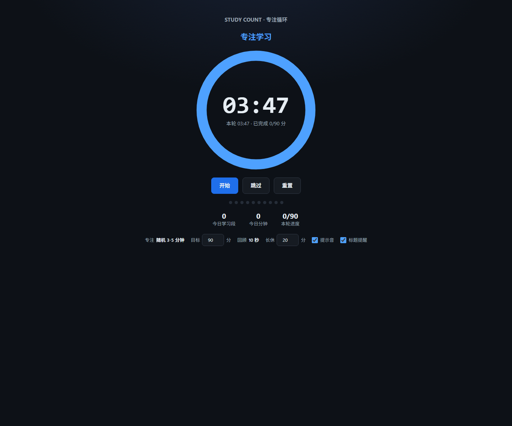

# Study Count

一个无需后端、打开即用的学习计时器。它把专注学习拆成 3-5 分钟的短轮次，用 10 秒闭眼回顾帮助巩固记忆，累计完成 90 分钟学习后进入 20 分钟长休息。



## 计时流程

1. 随机专注 **3-5 分钟**。学习时长精确到秒，每一轮都会重新随机。
2. 闭眼回顾 **10 秒**，在脑中快速回放刚才学到的内容。
3. 重复专注与回顾，直到本轮累计学习 **90 分钟**。
4. 进入 **20 分钟**长休息，结束后自动开始新的学习循环。

最后一段专注时间会自动缩短，确保累计学习时长不超过 90 分钟。页面下方也可以调整学习目标、长休时长、提示音和标题提醒。

## 功能

- 专注、闭眼回顾、长休息三阶段自动衔接
- 学习 3-5 分钟随机计时，精确到秒
- 90 分钟学习目标与 10 秒回忆间隔
- 今日学习段数、学习分钟数和本轮进度统计
- 使用 Web Audio 合成提示音，不依赖音频文件
- 页面切回前台后自动校正计时
- 通过 `localStorage` 保存当天统计，刷新页面不会清空
- 响应式布局，支持桌面与手机浏览器

## 使用

直接双击 `index.html` 即可使用，也可以启动一个本地静态服务器：

```bash
python -m http.server 8000
```

然后访问 <http://localhost:8000>。

### 快捷键

| 按键 | 操作 |
| --- | --- |
| `Space` | 开始或暂停 |
| `N` | 跳过当前阶段 |
| `R` | 重置本轮进度 |

## 数据说明

学习统计只保存在当前浏览器的 `localStorage` 中，键名格式为 `study_count_YYYY-M-D`。应用不会上传任何个人数据，清理浏览器站点数据会同时清除统计记录。

## 技术栈

- HTML5
- CSS3
- 原生 JavaScript

项目是单文件静态页面，没有构建步骤和第三方运行时依赖。

## 目录结构

```text
study_count/
├── index.html   # 计时器页面
├── preview.png  # README 页面预览
└── README.md
```

## GitHub Pages

如需在线使用，可在仓库的 **Settings > Pages** 中将来源设为 `Deploy from a branch`，选择 `main` 分支和 `/(root)` 目录。部署完成后，页面地址通常为：

```text
https://jieyou520.github.io/study_count/
```
